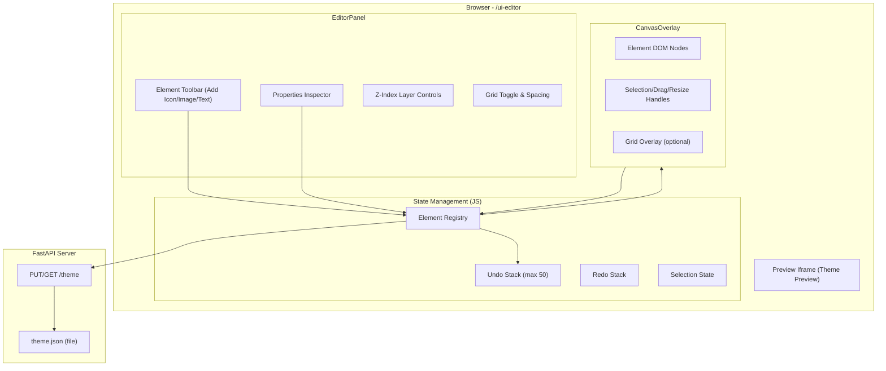
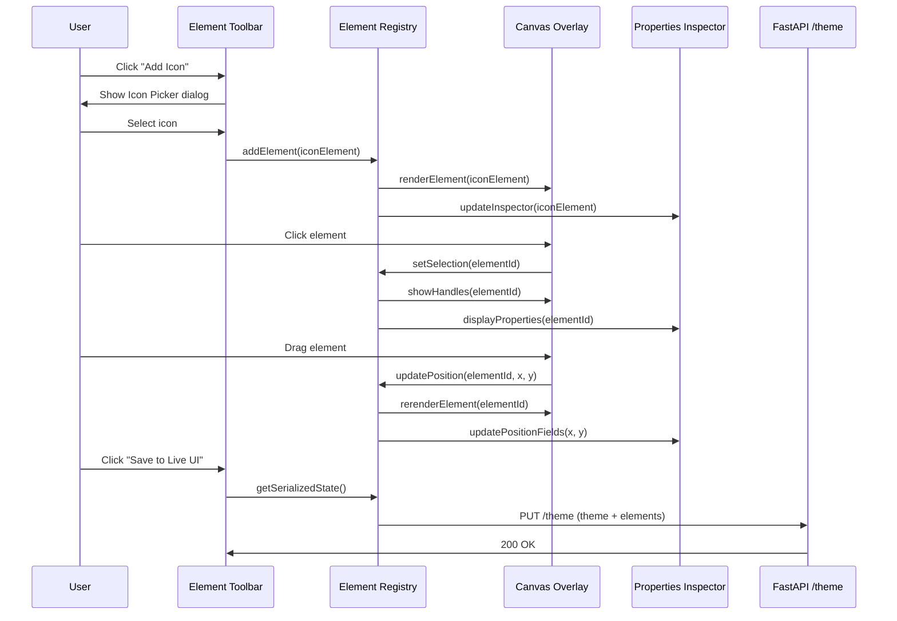

# Design Document: Dynamic UI Editor

## Overview

This design extends the existing Prep Pilot UI Editor (`/ui-editor`) from a static theme configurator into a dynamic visual editor. The current editor allows color, layout, and section toggle customization via a sidebar panel with live preview in an iframe. This enhancement adds a canvas-based element manipulation layer on top of the existing preview, enabling users to place, position, resize, and manage discrete visual elements (icons, images, text blocks) independently of the theme system.

The architecture follows a client-side-first approach using vanilla JavaScript (consistent with the existing editor), with server persistence via the existing FastAPI `/theme` endpoint extended to include element data. No build tools or frontend frameworks are introduced — the implementation remains a single-page HTML file with embedded CSS and JavaScript.

### Key Design Decisions

1. **Vanilla JS over framework**: The existing editor uses no framework. Introducing React/Vue would require a build pipeline. Keeping vanilla JS maintains consistency and zero-build deployment.
2. **Canvas overlay approach**: Elements are rendered as absolutely-positioned DOM nodes on a transparent overlay div that sits on top of the iframe preview, rather than injecting into the iframe. This avoids cross-origin issues and keeps element manipulation isolated.
3. **Element Registry as single source of truth**: All element state lives in a centralized JavaScript object (the Element_Registry). The DOM is a projection of this state. Undo/redo operates on snapshots of this registry.
4. **Extend existing persistence**: The `/theme` endpoint already saves/loads JSON. We extend the theme JSON schema with an `elements` array rather than creating a separate endpoint.

## Architecture



### Component Interaction Flow



## Components and Interfaces

### 1. Element Registry (State Manager)

The central state store managing all placed elements.

```javascript
// ElementRegistry interface
class ElementRegistry {
    constructor()
    
    // Element CRUD
    addElement(element: ElementData): string  // returns generated ID
    removeElement(id: string): void
    removeElements(ids: string[]): void
    getElement(id: string): ElementData | null
    getAllElements(): ElementData[]
    updateElement(id: string, updates: Partial<ElementData>): void
    
    // Selection
    getSelectedIds(): string[]
    setSelection(ids: string[]): void
    clearSelection(): void
    
    // Z-Index
    getMaxZIndex(): number
    getMinZIndex(): number
    bringToFront(id: string): void
    sendToBack(id: string): void
    moveForward(id: string): void
    moveBackward(id: string): void
    
    // Serialization
    serialize(): ElementData[]
    deserialize(data: ElementData[]): void
    
    // Undo/Redo
    pushUndoState(): void
    undo(): boolean
    redo(): boolean
    canUndo(): boolean
    canRedo(): boolean
    
    // Events
    onChange(callback: (elements: ElementData[]) => void): void
}
```

### 2. Canvas Renderer

Responsible for rendering elements as DOM nodes on the overlay and managing visual indicators.

```javascript
// CanvasRenderer interface
class CanvasRenderer {
    constructor(overlayElement: HTMLElement, registry: ElementRegistry)
    
    // Rendering
    renderAll(): void
    renderElement(id: string): void
    removeElementNode(id: string): void
    
    // Selection visuals
    showHandles(ids: string[]): void
    hideHandles(): void
    showMultiSelectBoundingBox(ids: string[]): void
    
    // Grid
    showGrid(spacing: number): void
    hideGrid(): void
    updateGridSpacing(spacing: number): void
    
    // Canvas info
    getCanvasBounds(): { width: number, height: number }
}
```

### 3. Interaction Handler

Manages mouse/keyboard events for drag, resize, and selection.

```javascript
// InteractionHandler interface
class InteractionHandler {
    constructor(canvas: CanvasRenderer, registry: ElementRegistry)
    
    // Drag
    startDrag(elementId: string, mouseEvent: MouseEvent): void
    onDragMove(mouseEvent: MouseEvent): void
    endDrag(): void
    
    // Resize
    startResize(elementId: string, handle: ResizeHandle, mouseEvent: MouseEvent): void
    onResizeMove(mouseEvent: MouseEvent): void
    endResize(): void
    
    // Selection
    handleClick(mouseEvent: MouseEvent): void
    handleShiftClick(mouseEvent: MouseEvent): void
    
    // Grid snapping
    setSnapEnabled(enabled: boolean): void
    setGridSpacing(spacing: number): void
    snapToGrid(value: number): number
}
```

### 4. Properties Inspector

Displays and edits properties of selected elements.

```javascript
// PropertiesInspector interface
class PropertiesInspector {
    constructor(panelElement: HTMLElement, registry: ElementRegistry)
    
    // Display
    showForElement(id: string): void
    showForMultiSelect(ids: string[]): void
    clear(): void
    
    // Updates
    updateLivePosition(x: number, y: number): void
    updateLiveSize(width: number, height: number): void
    
    // Layer controls
    showLayerControls(id: string): void
    disableLayerControls(): void
}
```

### 5. Icon Picker Dialog

Modal dialog for browsing and selecting icons.

```javascript
// IconPicker interface
class IconPicker {
    constructor()
    
    open(): Promise<IconSelection | null>  // null if cancelled
    close(): void
    
    // Search
    filterIcons(query: string): void
}

// IconSelection result
interface IconSelection {
    identifier: string  // e.g., "fa-home", "lucide-star"
    name: string
    svgContent: string
}
```

### 6. Image Uploader Dialog

Modal dialog for uploading or referencing images.

```javascript
// ImageUploader interface
class ImageUploader {
    constructor()
    
    open(): Promise<ImageSelection | null>  // null if cancelled
    close(): void
    
    // Validation
    validateFile(file: File): ValidationResult
    validateUrl(url: string): Promise<ValidationResult>
}

// ImageSelection result
interface ImageSelection {
    source: string      // data URL or external URL
    width: number       // natural width
    height: number      // natural height
    aspectRatio: number
}
```

### 7. Undo/Redo Manager

Manages state history with a capped stack.

```javascript
// UndoRedoManager interface
class UndoRedoManager {
    constructor(maxHistory: number)  // default 50
    
    pushState(state: ElementData[]): void
    undo(): ElementData[] | null
    redo(): ElementData[] | null
    canUndo(): boolean
    canRedo(): boolean
    clearRedoStack(): void
    clear(): void
}
```

## Data Models

### Element Data Model

```typescript
// Base element properties shared by all types
interface BaseElement {
    id: string           // UUID generated client-side
    type: 'icon' | 'image' | 'text'
    x: number            // pixels from canvas left
    y: number            // pixels from canvas top
    width: number        // pixels
    height: number       // pixels
    opacity: number      // 0.0 to 1.0
    zIndex: number       // integer, determines stacking order
}

// Icon element
interface IconElement extends BaseElement {
    type: 'icon'
    iconId: string       // identifier from icon library (e.g., "lucide-star")
    color: string        // hex color string (e.g., "#000000")
}

// Image element
interface ImageElement extends BaseElement {
    type: 'image'
    source: string       // data URL (base64) or external URL
    maintainAspectRatio: boolean
}

// Text element
interface TextElement extends BaseElement {
    type: 'text'
    content: string      // max 500 characters
    fontSize: number     // 8 to 128 pixels
    fontWeight: 'normal' | 'bold'
    color: string        // hex color string
}

// Union type
type ElementData = IconElement | ImageElement | TextElement
```

### Serialized Theme JSON (Extended)

```json
{
    "main": { /* existing theme data */ },
    "questions": { /* existing theme data */ },
    "evaluation": { /* existing theme data */ },
    "elements": [
        {
            "id": "uuid-1",
            "type": "icon",
            "iconId": "lucide-star",
            "x": 100,
            "y": 50,
            "width": 32,
            "height": 32,
            "color": "#000000",
            "opacity": 1.0,
            "zIndex": 1
        },
        {
            "id": "uuid-2",
            "type": "image",
            "source": "data:image/png;base64,...",
            "x": 200,
            "y": 100,
            "width": 150,
            "height": 100,
            "opacity": 1.0,
            "zIndex": 2,
            "maintainAspectRatio": true
        },
        {
            "id": "uuid-3",
            "type": "text",
            "content": "Welcome",
            "x": 50,
            "y": 300,
            "width": 200,
            "height": 40,
            "fontSize": 16,
            "fontWeight": "normal",
            "color": "#e2e8f0",
            "opacity": 1.0,
            "zIndex": 3
        }
    ]
}
```

### Undo State Snapshot

Each undo entry is a deep copy of the entire `elements` array at a point in time:

```typescript
interface UndoEntry {
    elements: ElementData[]  // deep clone of registry state
    timestamp: number        // Date.now() for debugging
}
```

### Grid Configuration

```typescript
interface GridConfig {
    enabled: boolean
    spacing: number   // 4 to 128 pixels, default 16
}
```

### Validation Constraints

| Property | Min | Max | Default |
|----------|-----|-----|---------|
| Icon width/height | 16px | Canvas dimension | 32px |
| Image width/height | 1px | 5000px | fit within 200x200 |
| Text font size | 8px | 128px | 16px |
| Text content length | 0 chars | 500 chars | — |
| Opacity | 0.0 | 1.0 | 1.0 |
| Z-Index | 0 | 1000 | auto-increment |
| Grid spacing | 4px | 128px | 16px |
| Image file size | — | 5MB | — |
| Undo stack depth | — | 50 entries | — |

## Correctness Properties

*A property is a characteristic or behavior that should hold true across all valid executions of a system — essentially, a formal statement about what the system should do. Properties serve as the bridge between human-readable specifications and machine-verifiable correctness guarantees.*

### Property 1: Element serialization round-trip

*For any* valid element (icon, image, or text) with arbitrary valid property values, serializing the element to JSON and then deserializing it back should produce an element that is deeply equal to the original, with all type-specific fields preserved.

**Validates: Requirements 1.3, 2.5, 7.4, 7.7, 10.7**

### Property 2: Icon search filter correctness

*For any* list of icons and any search query string, the filtered results should contain exactly those icons whose names contain the query as a case-insensitive substring — no false positives and no false negatives.

**Validates: Requirements 1.1**

### Property 3: New element z-index assignment

*For any* existing Element Registry state (including empty), when a new element of any type is added, its z-index should equal the maximum z-index of all existing elements plus one (or 1 if the registry is empty).

**Validates: Requirements 1.2, 10.1**

### Property 4: Property value validation

*For any* numeric property value outside its defined valid range (e.g., opacity > 1.0, width < minimum, font size > 128), the validator should reject the value. For any value within the valid range, the validator should accept it.

**Validates: Requirements 1.7**

### Property 5: Image file validation

*For any* file with a given format string and size in bytes, the file validator should accept the file if and only if the format is in {PNG, JPG, JPEG, SVG, WebP} (case-insensitive) AND the size is ≤ 5MB (5,242,880 bytes).

**Validates: Requirements 2.2**

### Property 6: Image scaling preserves aspect ratio within bounds

*For any* image with natural dimensions (width > 0, height > 0), the scaling function should produce dimensions that: (a) fit within 200×200 pixels, (b) maintain the original aspect ratio (width/height) within floating-point tolerance, and (c) maximize the size (at least one dimension equals 200, unless both natural dimensions are ≤ 200).

**Validates: Requirements 2.4**

### Property 7: Position clamping keeps elements within canvas

*For any* element with given width and height, and any target position (x, y), and any canvas dimensions, the clamped position should satisfy: 0 ≤ x ≤ canvasWidth − elementWidth AND 0 ≤ y ≤ canvasHeight − elementHeight.

**Validates: Requirements 3.6**

### Property 8: Drag position offset preservation

*For any* element at initial position (x₀, y₀) and any mouse movement delta (dx, dy), the computed new position (before clamping) should equal (x₀ + dx, y₀ + dy), preserving the offset between cursor and element origin.

**Validates: Requirements 3.3**

### Property 9: Corner resize maintains aspect ratio

*For any* element with initial dimensions (w, h) where w > 0 and h > 0, and any corner resize drag delta, the resulting dimensions (w', h') should satisfy w'/h' = w/h (within floating-point tolerance), and both w' ≥ 16 and h' ≥ 16.

**Validates: Requirements 4.2**

### Property 10: Edge resize changes only one axis

*For any* element with initial dimensions (w, h) and any edge midpoint resize drag, if the edge is horizontal (top/bottom), only the height should change; if the edge is vertical (left/right), only the width should change.

**Validates: Requirements 4.3**

### Property 11: Resize dimension clamping

*For any* resize operation on any element, the resulting dimensions should satisfy: 16 ≤ width ≤ canvasWidth AND 16 ≤ height ≤ canvasHeight.

**Validates: Requirements 4.5, 4.6**

### Property 12: Selection state machine

*For any* Element Registry with N elements and any sequence of click/shift-click operations: (a) a plain click on element E results in selection = {E}, (b) a shift-click on unselected element E adds E to selection, (c) a shift-click on selected element E removes E from selection, (d) a click on empty area results in selection = {}.

**Validates: Requirements 5.1, 5.2, 5.3, 5.4**

### Property 13: Multi-select group move preserves relative positions

*For any* set of selected elements with positions {(x₁,y₁), (x₂,y₂), ...} and any movement delta (dx, dy), after the group move, for every pair of elements (i, j), the relative offset (xᵢ − xⱼ, yᵢ − yⱼ) should remain unchanged.

**Validates: Requirements 5.6**

### Property 14: Delete removes exactly selected elements

*For any* Element Registry and any subset of selected element IDs, after deletion, the registry should contain exactly the elements that were NOT in the selection, with all their properties unchanged.

**Validates: Requirements 5.8**

### Property 15: Combined bounding box encompasses all elements

*For any* set of elements with positions and sizes, the computed combined bounding box should satisfy: for every element E, bbox.x ≤ E.x AND bbox.y ≤ E.y AND bbox.x + bbox.width ≥ E.x + E.width AND bbox.y + bbox.height ≥ E.y + E.height.

**Validates: Requirements 5.5**

### Property 16: Z-index layer operations

*For any* Element Registry with distinct z-indices: (a) "Bring to Front" sets the element's z-index to max(all z-indices) + 1, (b) "Send to Back" sets it to min(all z-indices) − 1, (c) "Move Forward" swaps z-index with the element having the next higher z-index, (d) "Move Backward" swaps with the element having the next lower z-index.

**Validates: Requirements 6.2, 6.3, 6.4, 6.5**

### Property 17: Render order follows z-index

*For any* set of elements, the render order should be sorted by ascending z-index, with elements sharing the same z-index ordered by their insertion time (earlier first).

**Validates: Requirements 6.6**

### Property 18: Snap to grid

*For any* numeric value and any valid grid spacing (4–128), the snapped value should equal round(value / spacing) × spacing, with a minimum snapped dimension of one grid increment for sizes.

**Validates: Requirements 8.2, 8.3**

### Property 19: Grid spacing change preserves element positions

*For any* Element Registry state and any valid new grid spacing value, changing the grid spacing should not modify any element's x, y, width, or height values.

**Validates: Requirements 8.4**

### Property 20: Grid spacing validation

*For any* input value, the grid spacing validator should accept it if and only if it is a numeric integer in the range [4, 128].

**Validates: Requirements 8.6**

### Property 21: Undo/redo round-trip

*For any* Element Registry state S₀ and any single modifying action A that produces state S₁, performing undo should restore state S₀, and then performing redo should restore state S₁.

**Validates: Requirements 9.1, 9.3, 9.4**

### Property 22: Continuous operation produces single undo entry

*For any* drag or resize operation consisting of N intermediate mouse-move events (N ≥ 1), exactly one undo entry should be created when the operation completes (mouse release), representing the state before the operation began.

**Validates: Requirements 9.2**

### Property 23: Undo stack capacity limit

*For any* sequence of K modifying actions where K > 50, the undo stack size should never exceed 50, and the oldest entries should be discarded first (FIFO eviction from the bottom).

**Validates: Requirements 9.5**

## Error Handling

### Client-Side Errors

| Error Scenario | Handling Strategy |
|---|---|
| Invalid property value (out of range) | Reject input, show inline error with valid range, retain previous value |
| Unsupported image format | Show error in Image_Uploader dialog listing accepted formats |
| Image file too large (>5MB) | Show error in Image_Uploader with size limit |
| Image URL load failure (timeout/invalid) | Show error in Image_Uploader, do not add element |
| Invalid grid spacing input | Reject input, show error, retain previous spacing |
| Text content exceeds 500 chars | Truncate at 500 characters, show character count indicator |
| Empty undo/redo stack | No-op, buttons remain disabled |

### Server Communication Errors

| Error Scenario | Handling Strategy |
|---|---|
| Save fails (network error) | Show error toast "Save failed — changes preserved locally", retain all state |
| Save fails (server 500) | Show error toast with retry suggestion, retain all state |
| Load fails on startup | Start with empty canvas, show warning that previous data couldn't be loaded |
| Theme JSON corrupted/invalid | Fall back to empty elements array, preserve valid theme data |

### Data Integrity

- Element IDs are generated using `crypto.randomUUID()` to prevent collisions
- Deep cloning for undo snapshots prevents reference sharing between states
- JSON serialization validates element structure before persisting (schema check)
- Image data URLs are validated for correct base64 format before storage

## Testing Strategy

### Property-Based Testing (Hypothesis)

The project already uses `hypothesis==6.152.7` for property-based testing. Each correctness property maps to a Hypothesis test with minimum 100 iterations.

**Library**: Hypothesis (Python) for backend validation logic; for client-side JS logic, tests will use a Node.js test runner with `fast-check` for property-based testing of the pure logic modules.

**Configuration**:
- Minimum 100 examples per property test
- Each test tagged with: `# Feature: dynamic-ui-editor, Property {N}: {title}`
- Generators produce random elements, positions, dimensions, and action sequences

**Property tests cover**:
- Element serialization/deserialization round-trip (Property 1)
- Icon search filtering (Property 2)
- Z-index assignment on add (Property 3)
- Property value validation (Property 4)
- File format/size validation (Property 5)
- Image scaling calculations (Property 6)
- Position clamping (Property 7)
- Drag offset calculation (Property 8)
- Proportional resize (Property 9)
- Single-axis resize (Property 10)
- Resize clamping (Property 11)
- Selection state transitions (Property 12)
- Group move relative positions (Property 13)
- Delete correctness (Property 14)
- Bounding box calculation (Property 15)
- Z-index operations (Property 16)
- Render order (Property 17)
- Snap-to-grid calculation (Property 18)
- Grid spacing preservation (Property 19)
- Grid spacing validation (Property 20)
- Undo/redo round-trip (Property 21)
- Single undo entry for continuous ops (Property 22)
- Undo stack capacity (Property 23)

### Unit Tests (Example-Based)

Unit tests cover specific scenarios, UI interactions, and integration points:

- Icon Picker dialog opens on button click
- Image Uploader dialog opens on button click
- Properties Inspector shows correct fields per element type
- Double-click enables text editing mode
- Escape/click-outside exits text editing
- Cursor changes on handle hover
- Save success/failure UI feedback
- Load on startup renders saved elements
- Reset with confirmation clears registry
- Reset cancel preserves state

### Integration Tests

- Full save/load cycle with FastAPI `/theme` endpoint
- Image URL loading with mocked HTTP responses
- Theme export includes both theme config and elements
- Keyboard shortcuts (Ctrl+Z, Ctrl+Y, Delete) trigger correct actions

### Manual Testing

- Visual verification of drag smoothness (60fps target)
- Resize handle positioning accuracy
- Grid overlay alignment
- Multi-select bounding box rendering
- Z-index visual stacking correctness

