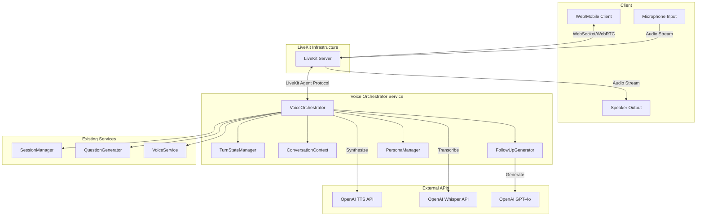
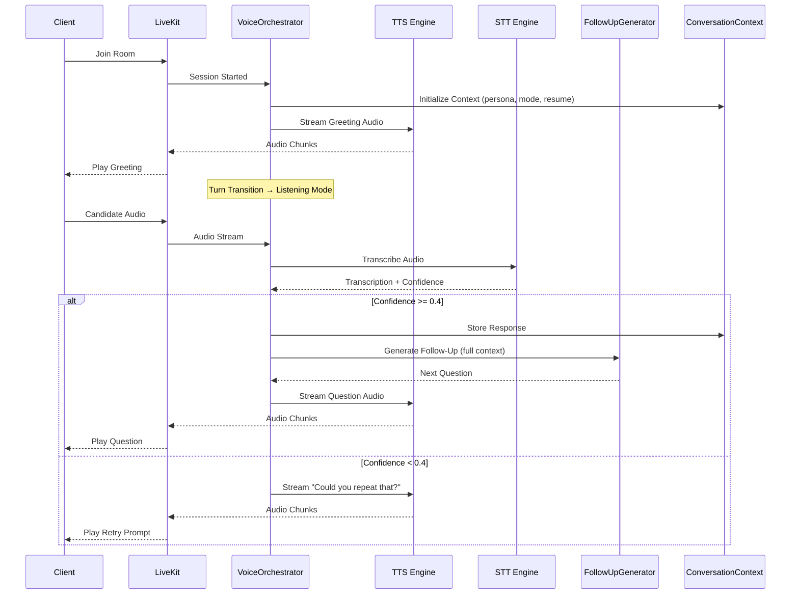
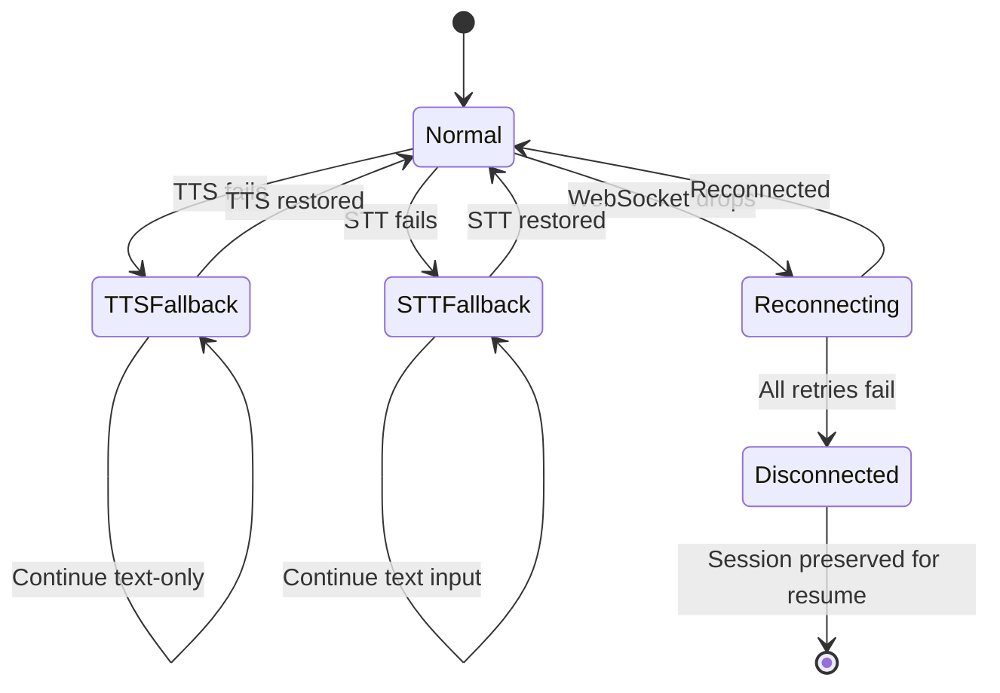

# Design Document: Interviewer Workflow

## Overview

This design describes the voice-first interview orchestration system for Prep Pilot. The Voice Orchestrator coordinates dynamic question generation, text-to-speech delivery, speech-to-text capture, context-aware follow-up generation, and natural turn-taking — all over a real-time WebSocket connection using LiveKit and OpenAI's voice APIs.

The system builds on the existing `VoiceService`, `SessionManager`, `QuestionGenerator`, and `VoiceWebSocketHandler` components. The primary architectural change is introducing a `VoiceOrchestrator` that manages the full voice interview loop as a stateful pipeline, replacing the current request-response WebSocket pattern with a streaming, event-driven conversation engine.

### Key Design Decisions

1. **LiveKit as the real-time transport layer** — The project already uses `livekit-agents` with OpenAI's Realtime API. The Voice Orchestrator will operate as a LiveKit agent that manages the interview state machine internally.
2. **Streaming TTS** — Audio is streamed chunk-by-chunk as it's generated rather than waiting for full synthesis, reducing perceived latency.
3. **Silence-based end-of-turn detection** — A 2-second silence gap signals end-of-turn, consistent with natural conversation patterns.
4. **Graceful degradation to text** — Every voice operation has a text fallback path so sessions never terminate due to transient voice service failures.
5. **Persona-driven question phrasing** — The `Interviewer_Persona` configuration shapes both the TTS voice and the LLM prompt style, producing observably different question wording across personas.

## Architecture



### Component Interaction Flow



## Components and Interfaces

### VoiceOrchestrator

The central coordinator that manages the voice interview lifecycle. It operates as a LiveKit Agent and drives the state machine through each interview turn.

```python
class VoiceOrchestrator:
    """Coordinates the full voice interview loop."""

    def __init__(
        self,
        session_manager: SessionManager,
        follow_up_generator: FollowUpGenerator,
        persona_manager: PersonaManager,
        tts_engine: TTSEngine,
        stt_engine: STTEngine,
        conversation_context: ConversationContext,
        config: OrchestratorConfig,
    ) -> None: ...

    async def start_session(
        self,
        session_id: str,
        mode: InterviewMode,
        persona: InterviewerPersona,
        resume: ParsedResume,
        job_description: Optional[ParsedJobDescription] = None,
        role: Optional[str] = None,
    ) -> None:
        """Initialize and begin the voice interview session."""
        ...

    async def deliver_question(self, question: InterviewQuestion) -> None:
        """Synthesize and stream a question to the candidate."""
        ...

    async def handle_candidate_audio(self, audio_data: bytes, duration: float) -> None:
        """Process incoming candidate audio through the STT pipeline."""
        ...

    async def handle_silence_timeout(self) -> None:
        """Handle candidate silence exceeding the configured threshold."""
        ...

    async def conclude_session(self, early_exit: bool = False) -> None:
        """Generate and deliver closing statement, transition to evaluation."""
        ...

    async def handle_tts_failure(self, question_text: str) -> None:
        """Fall back to text-only delivery when TTS fails."""
        ...

    async def handle_stt_failure(self) -> None:
        """Prompt candidate to use text input when STT fails."""
        ...
```

### TTSEngine

Wraps OpenAI's TTS API with streaming support and timeout handling.

```python
class TTSEngine:
    """Streaming text-to-speech engine using OpenAI TTS API."""

    TTS_TIMEOUT: int = 5  # seconds

    async def synthesize_stream(self, text: str, voice: str) -> AsyncIterator[bytes]:
        """Stream audio chunks as they are generated.

        Yields audio chunks for immediate delivery rather than
        waiting for full synthesis.

        Raises:
            TTSTimeoutError: If no response within TTS_TIMEOUT seconds.
            TTSConnectionError: If the API connection fails.
        """
        ...

    async def synthesize_full(self, text: str, voice: str) -> bytes:
        """Synthesize complete audio (fallback for short utterances)."""
        ...
```

### STTEngine

Wraps OpenAI's Whisper API with confidence scoring and silence detection.

```python
@dataclass
class TranscriptionResult:
    """Result from speech-to-text transcription."""
    text: str
    confidence: float  # 0.0 to 1.0
    has_recognizable_words: bool
    duration_seconds: float


class STTEngine:
    """Speech-to-text engine using OpenAI Whisper API."""

    TRANSCRIPTION_TIMEOUT: int = 5  # seconds
    SILENCE_THRESHOLD: float = 2.0  # seconds
    MAX_RECORDING_DURATION: int = 120  # seconds

    async def transcribe(self, audio_data: bytes, duration: float) -> TranscriptionResult:
        """Transcribe audio input with confidence scoring.

        Raises:
            STTTimeoutError: If transcription exceeds TRANSCRIPTION_TIMEOUT.
            STTUnavailableError: If the Whisper API is unreachable.
            AudioDurationError: If duration exceeds MAX_RECORDING_DURATION.
        """
        ...

    def detect_end_of_speech(self, audio_buffer: AudioBuffer) -> bool:
        """Detect if silence gap exceeds SILENCE_THRESHOLD."""
        ...
```

### TurnStateManager

Manages the state machine for conversational turn-taking.

```python
class TurnState(Enum):
    IDLE = "idle"
    DELIVERING_QUESTION = "delivering_question"
    AWAITING_RESPONSE = "awaiting_response"
    PROCESSING_RESPONSE = "processing_response"
    GENERATING_FOLLOWUP = "generating_followup"
    DELIVERING_CLOSING = "delivering_closing"
    SESSION_ENDED = "session_ended"


class TurnStateManager:
    """Manages turn-taking state transitions."""

    def __init__(self, config: TurnConfig) -> None: ...

    @property
    def current_state(self) -> TurnState: ...

    def transition_to(self, new_state: TurnState) -> None:
        """Transition to a new state, validating the transition is legal."""
        ...

    def start_silence_timer(self) -> None:
        """Start the silence detection timer (2s for end-of-turn, 15s for prompt, 30s for timeout)."""
        ...

    def cancel_silence_timer(self) -> None:
        """Cancel the active silence timer when speech is detected."""
        ...
```

### ConversationContext

Maintains the full dialogue history for context-aware generation.

```python
@dataclass
class ConversationTurn:
    """A single question-response pair in the conversation."""
    question: InterviewQuestion
    question_text: str
    response_text: str
    response_confidence: float
    timestamp: datetime
    topic: str
    probing_depth: int  # How many probing questions on this topic


class ConversationContext:
    """Maintains conversation history and topic tracking."""

    MAX_CONTEXT_RETENTION: int = 120  # seconds of interruption tolerance

    def __init__(
        self,
        mode: InterviewMode,
        persona: InterviewerPersona,
        resume: ParsedResume,
        job_description: Optional[ParsedJobDescription] = None,
        role: Optional[str] = None,
    ) -> None: ...

    def add_turn(self, turn: ConversationTurn) -> None:
        """Record a completed question-response turn."""
        ...

    def get_full_history(self) -> list[ConversationTurn]: ...

    def get_current_topic(self) -> str: ...

    def get_probing_depth(self) -> int: ...

    def get_topics_discussed(self) -> list[str]: ...

    def build_prompt_context(self) -> str:
        """Build the full context string for LLM prompt injection."""
        ...
```

### FollowUpGenerator

Generates context-aware follow-up questions with probing logic.

```python
@dataclass
class ResponseAssessment:
    """Assessment of candidate response thoroughness."""
    has_specific_example: bool
    has_quantifiable_result: bool
    sentence_count: int
    is_thorough: bool  # True if example/result present AND >= 2 sentences


class FollowUpGenerator:
    """Generates context-aware follow-up questions."""

    MAX_PROBING_DEPTH: int = 3
    GENERATION_TIMEOUT: float = 4.0  # seconds

    def __init__(self, llm_client: LLMClient, prompt_manager: PromptManager) -> None: ...

    async def generate(
        self,
        context: ConversationContext,
        fallback_questions: list[InterviewQuestion],
    ) -> InterviewQuestion:
        """Generate the next question based on conversation context.

        Assesses the candidate's last response for thoroughness.
        If insufficient, probes deeper (up to MAX_PROBING_DEPTH).
        If thorough, transitions to next topic with acknowledgment.

        Falls back to next pre-generated question if generation
        exceeds GENERATION_TIMEOUT.
        """
        ...

    def assess_response(self, response_text: str) -> ResponseAssessment:
        """Assess whether a response meets thoroughness criteria.

        A response is thorough if it contains at least one specific
        example or quantifiable result AND has 2+ complete sentences.
        """
        ...
```

### PersonaManager

Manages interviewer persona configurations.

```python
@dataclass
class InterviewerPersona:
    """Configuration for an interviewer persona."""
    id: str
    name: str
    tts_voice: str  # OpenAI TTS voice identifier
    style: str  # "formal", "conversational", "challenging"
    difficulty: str  # "easy", "moderate", "hard"
    greeting_template: str
    question_style_prompt: str  # Injected into LLM prompts to shape phrasing


DEFAULT_PERSONA = InterviewerPersona(
    id="default",
    name="Professional Interviewer",
    tts_voice="alloy",
    style="formal",
    difficulty="moderate",
    greeting_template="Hello {name}, I'm {persona_name}. Today we'll be doing a {mode} interview with approximately {question_count} questions. Let's get started.",
    question_style_prompt="Ask questions in a professional, formal tone appropriate for a corporate interview setting.",
)


class PersonaManager:
    """Manages available interviewer personas."""

    def __init__(self) -> None: ...

    def get_available_personas(self) -> list[InterviewerPersona]: ...

    def get_persona(self, persona_id: str) -> InterviewerPersona: ...

    def get_default_persona(self) -> InterviewerPersona: ...
```

### OrchestratorConfig

```python
@dataclass
class OrchestratorConfig:
    """Configuration constants for the Voice Orchestrator."""
    tts_timeout: float = 5.0  # seconds before TTS fallback
    stt_timeout: float = 5.0  # seconds for transcription
    silence_end_of_turn: float = 2.0  # seconds of silence = end of turn
    silence_prompt: float = 15.0  # seconds before prompting candidate
    silence_timeout: float = 30.0  # seconds before requiring text input
    max_recording_duration: float = 120.0  # max candidate response length
    min_confidence: float = 0.4  # minimum STT confidence threshold
    max_retry_attempts: int = 2  # retries for low-confidence transcription
    followup_timeout: float = 4.0  # seconds for follow-up generation
    max_probing_depth: int = 3  # max consecutive probing questions
    greeting_min_duration: float = 10.0  # seconds
    greeting_max_duration: float = 30.0  # seconds
    closing_min_duration: float = 10.0  # seconds
    closing_max_duration: float = 30.0  # seconds
    websocket_keepalive_interval: float = 30.0  # seconds
    websocket_reconnect_timeout: float = 3.0  # seconds per attempt
    websocket_max_reconnect_attempts: int = 3
    context_retention_duration: float = 120.0  # seconds to preserve context during interruption
    max_roundtrip_time: float = 6.0  # seconds from end-of-speech to next question audio
    turn_transition_delay: float = 0.5  # seconds after TTS completes before listening
```

### WebSocket Protocol Messages

```python
# Server → Client messages
class ServerMessage:
    """Messages sent from server to client."""

    # Question delivery
    QUESTION = {
        "type": "question",
        "question_id": str,
        "question_text": str,
        "category": str,
    }

    # Ready to receive audio
    READY_TO_RECEIVE = {
        "type": "ready_to_receive",
        "message": "You may begin speaking now.",
    }

    # Transcription result
    TRANSCRIPTION = {
        "type": "transcription",
        "text": str,
        "confidence": float,
    }

    # Session concluded
    SESSION_CONCLUDED = {
        "type": "session_concluded",
        "closing_text": str,
        "message": "Generating your evaluation results...",
    }

    # Voice unavailable notification
    VOICE_UNAVAILABLE = {
        "type": "voice_unavailable",
        "service": str,  # "tts" or "stt"
        "message": str,
        "fallback": str,  # "text_only" or "text_input"
    }

    # Voice restored notification
    VOICE_RESTORED = {
        "type": "voice_restored",
        "service": str,
        "message": "Voice interaction has been restored.",
    }

    # Prompt to respond
    SILENCE_PROMPT = {
        "type": "silence_prompt",
        "message": "Would you like me to repeat the question, or would you prefer to move to the next one?",
    }

    # Connection lost
    CONNECTION_LOST = {
        "type": "connection_lost",
        "message": str,
        "can_resume": bool,
        "last_question_index": int,
    }
```

## Data Models

### New Domain Models

```python
@dataclass
class VoiceSessionState:
    """Runtime state of an active voice session."""
    session_id: str
    persona: InterviewerPersona
    mode: InterviewMode
    turn_state: TurnState
    conversation_context: ConversationContext
    current_question_index: int
    total_questions: int
    retry_count: int  # Current retry count for low-confidence transcriptions
    tts_available: bool
    stt_available: bool
    websocket_connected: bool
    last_confirmed_index: int  # For reconnection recovery
    created_at: datetime
    last_activity_at: datetime


@dataclass
class VoiceSessionConfig:
    """Configuration provided at session start."""
    session_id: str
    persona_id: Optional[str]  # None = use default
    mode: InterviewMode
    resume: ParsedResume
    job_description: Optional[ParsedJobDescription]
    role: Optional[str]
    question_count: int = 10


@dataclass
class ClosingStatement:
    """Generated closing statement for session conclusion."""
    text: str
    topics_referenced: list[str]  # At least 2 topics
    acknowledgment: str  # Positive acknowledgment phrase
    sign_off: str  # Natural sign-off phrase
    duration_estimate: float  # Estimated audio duration in seconds
```

### Extended Existing Models

The existing `InterviewSession` model gains a reference to the voice session state:

```python
@dataclass
class InterviewSession:
    """Extended with voice session tracking."""
    # ... existing fields ...
    voice_session_state: Optional[VoiceSessionState] = None
    voice_enabled: bool = False
```

### Persona Data Store

```python
INTERVIEWER_PERSONAS: list[InterviewerPersona] = [
    InterviewerPersona(
        id="professional",
        name="Alex",
        tts_voice="alloy",
        style="formal",
        difficulty="moderate",
        greeting_template="Good day, {name}. I'm Alex, and I'll be conducting your {mode} interview today. We have approximately {question_count} questions prepared. Shall we begin?",
        question_style_prompt="Ask questions in a professional, formal tone. Use precise language and expect structured, detailed answers.",
    ),
    InterviewerPersona(
        id="friendly",
        name="Sam",
        tts_voice="nova",
        style="conversational",
        difficulty="easy",
        greeting_template="Hey {name}! I'm Sam. Welcome to your {mode} practice session. We've got about {question_count} questions lined up, but don't worry — just think of this as a friendly chat. Ready when you are!",
        question_style_prompt="Ask questions in a warm, conversational tone. Use casual language and encourage the candidate to share stories naturally.",
    ),
    InterviewerPersona(
        id="challenger",
        name="Morgan",
        tts_voice="onyx",
        style="challenging",
        difficulty="hard",
        greeting_template="Hello {name}. I'm Morgan. This will be a rigorous {mode} interview with {question_count} questions. I'll be looking for depth, specifics, and evidence of impact. Let's begin.",
        question_style_prompt="Ask probing, challenging questions. Push for specifics, metrics, and evidence. Use a direct, no-nonsense tone that tests the candidate's composure.",
    ),
]
```


## Correctness Properties

*A property is a characteristic or behavior that should hold true across all valid executions of a system — essentially, a formal statement about what the system should do. Properties serve as the bridge between human-readable specifications and machine-verifiable correctness guarantees.*

### Property 1: TTS Failure Always Results in Text Fallback

*For any* question text and any TTS failure scenario (timeout after 5 seconds, connection error, or mid-stream interruption), the Voice Orchestrator SHALL deliver the complete question text as a JSON message to the client with a notification field indicating voice output is temporarily unavailable, and the session SHALL continue without termination.

**Validates: Requirements 1.4, 1.5, 7.5, 9.1**

### Property 2: Turn Transition Within 500 Milliseconds

*For any* completed question delivery (TTS audio playback finished or text-only delivery confirmed), the Voice Orchestrator SHALL transition to listening mode and emit a ready-to-receive signal to the client within 500 milliseconds of delivery completion.

**Validates: Requirements 2.1, 4.1, 7.2**

### Property 3: STT Failure Results in Text Input Fallback

*For any* point during an active voice session where the STT Engine becomes unavailable, the Voice Orchestrator SHALL notify the client to fall back to text input mode and the session SHALL continue without ending.

**Validates: Requirements 2.6, 9.2**

### Property 4: Confidence Scoring and Threshold Decision

*For any* audio input that produces a transcription, the confidence score SHALL be a float in [0.0, 1.0]. *For any* transcription with confidence >= 0.4, the orchestrator SHALL accept it as the candidate's response. *For any* transcription with confidence < 0.4, the orchestrator SHALL prompt for retry (up to 2 attempts) then require text input.

**Validates: Requirements 2.3, 2.4, 2.5**

### Property 5: Response Thoroughness Determines Probing vs Advancing

*For any* candidate response, if the response lacks a specific example or quantifiable result AND contains fewer than 2 complete sentences, the Follow Up Generator SHALL probe deeper on the same topic. If the response contains at least one specific example or quantifiable result AND has 2 or more complete sentences, the Follow Up Generator SHALL transition to the next topic. After 3 consecutive probing questions on the same topic without a thorough response, the generator SHALL advance to the next topic regardless.

**Validates: Requirements 3.3, 3.4, 3.6**

### Property 6: Full Context Passed to Follow-Up Generator

*For any* conversation with N completed turns, when the Follow Up Generator is invoked to produce the next question, it SHALL receive all N prior question-response pairs as input context.

**Validates: Requirements 3.1**

### Property 7: Follow-Up References Candidate's Last Response

*For any* generated follow-up question, the question text SHALL include a reference to or acknowledgment of at least one specific element (named skill, claim, example, or topic) from the candidate's most recent response.

**Validates: Requirements 3.2**

### Property 8: No Interruption While Candidate Speaks

*For any* state where the Voice Orchestrator is in AWAITING_RESPONSE mode and candidate audio input is being received, the orchestrator SHALL NOT produce any outgoing audio or deliver the next question until end-of-turn is detected.

**Validates: Requirements 4.3**

### Property 9: Greeting Contains Required Elements

*For any* persona and interview mode combination, the generated greeting text SHALL contain the interviewer persona name, the interview mode description, and the expected number of questions, with an estimated audio duration between 10 and 30 seconds.

**Validates: Requirements 4.4**

### Property 10: Prompt Context Includes Mode-Appropriate Elements

*For any* Open Practice session with a resume containing extractable skills, the prompt context SHALL include the selected role name and at least one resume skill or experience. *For any* Job Specific session, the prompt context SHALL include at least one JD requirement/responsibility/qualification and at least one resume skill or experience.

**Validates: Requirements 5.1, 5.2**

### Property 11: Job Specific Follow-Ups Reference Job Description

*For any* follow-up question generated during a Job Specific mode session, the question SHALL reference at least one specific requirement, responsibility, or qualification from the parsed job description.

**Validates: Requirements 5.4**

### Property 12: Persona Consistency Throughout Session

*For any* voice session with a selected persona, all TTS output SHALL use the same voice identifier and all generated questions SHALL use the same style prompt for the entire duration of the session.

**Validates: Requirements 6.1**

### Property 13: Different Personas Produce Different Wording

*For any* question topic and any two distinct personas, the generated question text SHALL differ in wording while preserving the core subject matter being asked about.

**Validates: Requirements 6.3**

### Property 14: Text Always Accompanies Audio Delivery

*For any* audio delivery (question or closing statement), the Voice Orchestrator SHALL send the corresponding text as a JSON message to the client no later than the start of audio playback.

**Validates: Requirements 1.3, 8.5**

### Property 15: WebSocket Reconnection with Bounded Retries and State Recovery

*For any* WebSocket disconnection during an active session, the Voice Session SHALL attempt reconnection within 3 seconds per attempt for a maximum of 3 attempts. Upon successful reconnection, the session SHALL resume from the last confirmed question-response pair.

**Validates: Requirements 7.6, 9.3**

### Property 16: Slow Responses Never Discarded

*For any* response processing that exceeds the 6-second round-trip target, the Voice Orchestrator SHALL still deliver the next question audio upon completion and SHALL NOT discard or skip the pending response.

**Validates: Requirements 7.7**

### Property 17: Closing References Topics Discussed

*For any* completed session (full or early exit) with at least 2 topics discussed, the closing statement SHALL reference at least 2 specific topics, skills, or examples the candidate discussed. For early exits, the closing SHALL also acknowledge the early conclusion gracefully.

**Validates: Requirements 8.2, 8.7**

### Property 18: Closing Contains Acknowledgment and Sign-Off

*For any* generated closing statement, the text SHALL include a brief positive acknowledgment of the candidate's participation and a natural sign-off phrase.

**Validates: Requirements 8.3**

### Property 19: Closing Duration Within Bounds

*For any* generated closing statement, the estimated audio duration SHALL be between 10 and 30 seconds.

**Validates: Requirements 8.4**

### Property 20: Context Preserved During Interruption

*For any* service interruption (TTS or STT failure) lasting up to 120 seconds, the Voice Orchestrator SHALL preserve the full Conversation Context. When the failed service becomes available again, the orchestrator SHALL resume voice interaction mode and notify the candidate.

**Validates: Requirements 9.4**

### Property 21: Follow-Up Timeout Triggers Fallback

*For any* follow-up generation attempt that exceeds 4 seconds, the Voice Orchestrator SHALL fall back to the next pre-generated question from the session's question list rather than waiting indefinitely.

**Validates: Requirements 9.5**

### Property 22: All Retries Exhausted Preserves Context with Resume Option

*For any* session where all 3 WebSocket reconnection attempts fail, the Voice Session SHALL end the real-time connection, preserve the current Conversation Context, and provide the client with a message indicating the interruption and an option to start a new session that resumes from the last confirmed question-response pair.

**Validates: Requirements 9.6**

### Property 23: Silence Detection at 2-Second Threshold

*For any* audio stream during listening mode, a silence gap of exactly 2 seconds or more SHALL trigger end-of-turn detection, and silence gaps shorter than 2 seconds SHALL NOT trigger end-of-turn detection.

**Validates: Requirements 4.2, 2.2**

## Error Handling

### Error Categories and Recovery Strategies

| Error Category | Trigger | Recovery Action | User Impact |
|---|---|---|---|
| TTS Timeout | No TTS response within 5s | Deliver text-only + notification | Reads question instead of hearing it |
| TTS Connection Error | API unreachable | Deliver text-only + notification | Reads question instead of hearing it |
| TTS Mid-Stream Failure | Audio stream interrupted | Deliver full text as JSON | Reads remainder of question |
| STT Timeout | Transcription exceeds 5s | Retry once, then text input prompt | Types response instead of speaking |
| STT Unavailable | Whisper API unreachable | Prompt text input, session continues | Types all responses |
| Low Confidence | Confidence < 0.4 | Prompt retry (max 2), then text input | Repeats answer or types it |
| No Speech Detected | 30s silence in listening mode | Prompt to respond or use text | Reminded to answer |
| Follow-Up Timeout | Generation exceeds 4s | Use next pre-generated question | Slightly less contextual question |
| WebSocket Drop | Connection lost | Auto-reconnect (3 attempts, 3s each) | Brief pause, then resumes |
| WebSocket Permanent Failure | All 3 reconnects fail | End connection, preserve context, offer resume | Must rejoin session |
| Context Expiry | Interruption > 120s | Context may be lost | May need to restart |

### Error State Machine



### Graceful Degradation Hierarchy

1. **Full Voice Mode** — TTS + STT + streaming (optimal experience)
2. **TTS Fallback** — Text questions + STT responses (voice input still works)
3. **STT Fallback** — TTS questions + text responses (voice output still works)
4. **Text-Only Mode** — Text questions + text responses (minimum viable experience)
5. **Disconnected** — Context preserved, session can be resumed

The system never terminates a session due to a single service failure. It degrades gracefully through the hierarchy and can recover upward when services are restored.

## Testing Strategy

### Property-Based Testing

This feature is well-suited for property-based testing because:
- The core logic involves pure functions (response assessment, prompt construction, state transitions)
- Universal properties hold across a wide range of inputs (any question text, any response, any persona)
- The input space is large (arbitrary text, varying confidence scores, multiple personas/modes)

**Library**: [Hypothesis](https://hypothesis.readthedocs.io/) (Python PBT library)

**Configuration**:
- Minimum 100 iterations per property test
- Each test tagged with: `Feature: interviewer-workflow, Property {N}: {title}`

**Properties to implement as PBT**:
- Property 4: Confidence scoring and threshold decision
- Property 5: Response thoroughness determines probing vs advancing
- Property 6: Full context passed to follow-up generator
- Property 8: No interruption while candidate speaks (state machine invariant)
- Property 9: Greeting contains required elements
- Property 10: Prompt context includes mode-appropriate elements
- Property 12: Persona consistency throughout session
- Property 13: Different personas produce different wording
- Property 14: Text always accompanies audio delivery
- Property 16: Slow responses never discarded
- Property 17: Closing references topics discussed
- Property 18: Closing contains acknowledgment and sign-off
- Property 23: Silence detection at 2-second threshold

### Unit Tests (Example-Based)

- Default persona selection when none specified (Req 6.4)
- Persona list API returns all required fields (Req 6.5)
- 15-second silence triggers prompt (Req 4.6)
- 30-second silence triggers text input requirement (Req 2.7)
- Session conclusion triggers evaluation phase (Req 8.6)
- Empty resume handling in both modes (Req 5.5)

### Integration Tests

- End-to-end round-trip time measurement (Req 7.3)
- TTS streaming delivers chunks incrementally (Req 7.1)
- WebSocket keep-alive at 30-second intervals (Req 7.4)
- Follow-up generation completes within 4 seconds (Req 3.5)
- Full voice loop: question → response → follow-up (smoke test)

### Mocking Strategy

- **OpenAI TTS API**: Mock with configurable latency and failure modes
- **OpenAI Whisper API**: Mock with configurable confidence scores and transcription text
- **OpenAI GPT-4o**: Mock with configurable response text and latency
- **LiveKit**: Mock the agent session and room for unit/property tests
- **WebSocket**: Mock connection with configurable disconnect/reconnect behavior

### Test Organization

```
tests/
├── property/
│   ├── test_confidence_threshold.py
│   ├── test_response_assessment.py
│   ├── test_context_passing.py
│   ├── test_state_machine.py
│   ├── test_greeting_generation.py
│   ├── test_prompt_construction.py
│   ├── test_persona_consistency.py
│   ├── test_closing_statement.py
│   └── test_silence_detection.py
├── unit/
│   ├── test_voice_orchestrator.py
│   ├── test_turn_state_manager.py
│   ├── test_follow_up_generator.py
│   ├── test_persona_manager.py
│   └── test_conversation_context.py
└── integration/
    ├── test_voice_loop.py
    ├── test_websocket_reconnection.py
    └── test_streaming_performance.py
```
