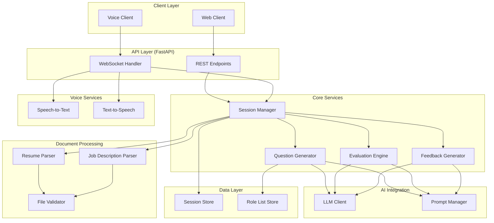

# Design Document: Prep Pilot

## Overview

Prep Pilot is an AI-powered mock interview agent built in Python that conducts personalized interview sessions based on a user's resume and target role. The system parses uploaded documents, generates contextual interview questions using an LLM, evaluates responses across multiple dimensions, and delivers structured feedback reports. It supports both voice and text interaction modalities.

The architecture follows a layered design with clear separation between the API layer, core business logic, AI/LLM integration, document processing, and voice services. FastAPI serves as the web framework, providing async request handling and WebSocket support for real-time voice interaction.

## Architecture



### Key Architectural Decisions

1. **FastAPI as the web framework**: Provides native async support, automatic OpenAPI documentation, Pydantic validation, and WebSocket support for voice streaming. Recommended for Python 3.10+ AI applications.

2. **Service-oriented internal structure**: Each major capability (parsing, question generation, evaluation, feedback) is encapsulated in its own service class with defined interfaces. This enables independent testing and future scaling.

3. **LLM abstraction layer**: A unified LLM client wraps the underlying model provider (OpenAI API), allowing prompt management and model switching without changing business logic.

4. **Async-first design**: All I/O-bound operations (LLM calls, file parsing, voice transcription) use async/await patterns to handle concurrent sessions efficiently.

5. **Stateful session management**: Interview sessions maintain state (questions asked, responses received, mode, parsed documents) in memory with optional persistence, enabling multi-turn conversational flow.

## Components and Interfaces

### 1. File Validator (`file_validator.py`)

Validates uploaded files before processing.

```python
class FileValidator:
    ALLOWED_RESUME_FORMATS: list[str] = ["application/pdf", "application/vnd.openxmlformats-officedocument.wordprocessingml.document"]
    ALLOWED_JD_FORMATS: list[str] = ["application/pdf", "application/vnd.openxmlformats-officedocument.wordprocessingml.document", "text/plain"]
    MAX_FILE_SIZE_BYTES: int = 5 * 1024 * 1024  # 5 MB

    def validate(self, file: UploadedFile, allowed_formats: list[str]) -> ValidationResult:
        """Validate file format and size. Returns ValidationResult with success/error."""
        ...
```

### 2. Resume Parser (`resume_parser.py`)

Extracts structured information from resume documents.

```python
@dataclass
class ParsedResume:
    skills: list[str]
    experiences: list[Experience]
    qualifications: list[str]
    raw_text: str

class ResumeParser:
    async def parse(self, file_content: bytes, file_type: str) -> ParsedResume:
        """Parse resume and extract skills, experiences, qualifications."""
        ...
```

### 3. Job Description Parser (`jd_parser.py`)

Extracts role requirements from job descriptions.

```python
@dataclass
class ParsedJobDescription:
    requirements: list[str]
    responsibilities: list[str]
    qualifications: list[str]
    summary: str

class JobDescriptionParser:
    async def parse(self, file_content: bytes, file_type: str) -> ParsedJobDescription:
        """Parse job description and extract requirements, responsibilities, qualifications."""
        ...
```

### 4. Question Generator (`question_generator.py`)

Generates interview questions based on mode, role, resume, and optionally job description.

```python
class QuestionGenerator:
    async def generate_open_practice(
        self, role: str, resume: ParsedResume, count: int
    ) -> list[InterviewQuestion]:
        """Generate 5-15 questions for open practice mode."""
        ...

    async def generate_job_specific(
        self, resume: ParsedResume, job_description: ParsedJobDescription
    ) -> list[InterviewQuestion]:
        """Generate questions targeting intersections of resume and JD."""
        ...
```

### 5. Evaluation Engine (`evaluation_engine.py`)

Scores interview responses across multiple dimensions.

```python
@dataclass
class InterviewReadinessScore:
    clarity_of_communication: int  # 1-10
    technical_accuracy: int        # 1-10
    star_method_adherence: int     # 1-10
    overall_response_relevancy: int  # 1-10

@dataclass
class ResumeRelevancyResult:
    score: int  # 1-10
    per_question_reasoning: list[QuestionRelevancyDetail]

class EvaluationEngine:
    async def evaluate_readiness(
        self, questions: list[InterviewQuestion], responses: list[str], resume: ParsedResume
    ) -> InterviewReadinessScore:
        """Evaluate interview performance across 4 dimensions."""
        ...

    async def evaluate_resume_relevancy(
        self, questions: list[InterviewQuestion], responses: list[str], resume: ParsedResume
    ) -> ResumeRelevancyResult:
        """Score alignment between responses and resume content."""
        ...
```

### 6. Feedback Generator (`feedback_generator.py`)

Produces the structured feedback report.

```python
@dataclass
class FeedbackReport:
    improved_answers: list[ImprovedAnswer]
    follow_up_questions: list[str]  # 2-5 questions
    score_reasoning: list[ScoreReasoning]
    improvement_suggestions: list[ImprovementSuggestion]

class FeedbackGenerator:
    async def generate(
        self, session: InterviewSession
    ) -> FeedbackReport:
        """Generate complete feedback report from session data."""
        ...
```

### 7. Session Manager (`session_manager.py`)

Orchestrates the interview flow and maintains session state.

```python
class SessionManager:
    async def create_session(self, resume: ParsedResume, mode: InterviewMode) -> InterviewSession:
        ...

    async def submit_response(self, session_id: str, response: str) -> NextAction:
        ...

    async def conclude_session(self, session_id: str) -> SessionResults:
        ...
```

### 8. Voice Service (`voice_service.py`)

Handles speech-to-text and text-to-speech operations.

```python
class VoiceService:
    MAX_RECORDING_DURATION: int = 120  # seconds
    TRANSCRIPTION_TIMEOUT: int = 10    # seconds

    async def transcribe(self, audio_data: bytes) -> TranscriptionResult:
        """Convert voice input to text within 10 seconds."""
        ...

    async def synthesize(self, text: str) -> bytes:
        """Convert text response to audio output."""
        ...
```

### 9. LLM Client (`llm_client.py`)

Abstraction over the LLM provider for all AI operations.

```python
class LLMClient:
    async def generate(self, prompt: str, system_prompt: str, **kwargs) -> str:
        """Send prompt to LLM and return response text."""
        ...

    async def generate_structured(self, prompt: str, system_prompt: str, schema: type) -> Any:
        """Send prompt and parse response into structured output."""
        ...
```

### 10. Prompt Manager (`prompt_manager.py`)

Manages prompt templates for different operations.

```python
class PromptManager:
    def get_question_generation_prompt(self, role: str, resume: ParsedResume, mode: str) -> str:
        ...

    def get_evaluation_prompt(self, dimension: str, question: str, response: str) -> str:
        ...

    def get_feedback_prompt(self, session: InterviewSession) -> str:
        ...
```

## Data Models

### Core Domain Models

```python
from enum import Enum
from dataclasses import dataclass, field
from datetime import datetime
from typing import Optional

class InterviewMode(Enum):
    OPEN_PRACTICE = "open_practice"
    JOB_SPECIFIC = "job_specific"

class SessionStatus(Enum):
    AWAITING_RESUME = "awaiting_resume"
    AWAITING_MODE_SELECTION = "awaiting_mode_selection"
    AWAITING_ROLE_SELECTION = "awaiting_role_selection"
    AWAITING_JOB_DESCRIPTION = "awaiting_job_description"
    IN_PROGRESS = "in_progress"
    CONCLUDED = "concluded"

@dataclass
class Experience:
    title: str
    company: str
    duration: str
    description: str
    skills_used: list[str]

@dataclass
class ParsedResume:
    skills: list[str]
    experiences: list[Experience]
    qualifications: list[str]
    raw_text: str

@dataclass
class ParsedJobDescription:
    requirements: list[str]
    responsibilities: list[str]
    qualifications: list[str]
    summary: str

@dataclass
class InterviewQuestion:
    id: str
    text: str
    category: str
    references_resume_item: Optional[str] = None
    references_jd_item: Optional[str] = None

@dataclass
class QuestionResponse:
    question: InterviewQuestion
    response_text: str
    response_timestamp: datetime
    input_mode: str  # "voice" or "text"

@dataclass
class InterviewSession:
    id: str
    mode: InterviewMode
    status: SessionStatus
    resume: ParsedResume
    job_description: Optional[ParsedJobDescription] = None
    selected_role: Optional[str] = None
    questions: list[InterviewQuestion] = field(default_factory=list)
    responses: list[QuestionResponse] = field(default_factory=list)
    current_question_index: int = 0
    created_at: datetime = field(default_factory=datetime.now)

@dataclass
class InterviewReadinessScore:
    clarity_of_communication: int  # 1-10
    technical_accuracy: int        # 1-10
    star_method_adherence: int     # 1-10
    overall_response_relevancy: int  # 1-10

@dataclass
class QuestionRelevancyDetail:
    question_id: str
    supported_claims: list[str]
    unsupported_claims: list[str]
    reasoning: str

@dataclass
class ResumeRelevancyResult:
    score: int  # 1-10
    per_question_reasoning: list[QuestionRelevancyDetail]

@dataclass
class ImprovedAnswer:
    question_id: str
    original_response: str
    improved_response: str

@dataclass
class ScoreReasoning:
    dimension: str
    score: int
    reasoning: str
    referenced_responses: list[str]

@dataclass
class ImprovementSuggestion:
    dimension: str
    suggestion: str
    referenced_response: str

@dataclass
class FeedbackReport:
    improved_answers: list[ImprovedAnswer]
    follow_up_questions: list[str]
    score_reasoning: list[ScoreReasoning]
    improvement_suggestions: list[ImprovementSuggestion]

@dataclass
class SessionResults:
    readiness_score: Optional[InterviewReadinessScore]
    resume_relevancy: Optional[ResumeRelevancyResult]
    feedback_report: Optional[FeedbackReport]
    insufficient_responses: bool = False

@dataclass
class ValidationResult:
    is_valid: bool
    error_message: Optional[str] = None

@dataclass
class TranscriptionResult:
    text: str
    confidence: float
    has_recognizable_words: bool
```

### API Request/Response Models (Pydantic)

```python
from pydantic import BaseModel, Field

class StartSessionResponse(BaseModel):
    session_id: str
    status: str

class UploadResumeResponse(BaseModel):
    skills: list[str]
    experiences: list[dict]
    qualifications: list[str]
    confirmation_required: bool = True

class SelectModeRequest(BaseModel):
    mode: str  # "open_practice" or "job_specific"
    role: str | None = None  # Required for open_practice

class QuestionResponse(BaseModel):
    question_id: str
    question_text: str
    category: str

class SubmitAnswerRequest(BaseModel):
    response_text: str
    input_mode: str = "text"

class SessionResultsResponse(BaseModel):
    readiness_score: dict | None
    resume_relevancy: dict | None
    feedback_report: dict | None
    message: str | None = None
```

## Correctness Properties

*A property is a characteristic or behavior that should hold true across all valid executions of a system—essentially, a formal statement about what the system should do. Properties serve as the bridge between human-readable specifications and machine-verifiable correctness guarantees.*

### Property 1: File validation accepts only valid formats and sizes

*For any* uploaded file, the file validator SHALL accept the file if and only if its MIME type is in the allowed formats list for the document type (PDF/DOCX for resumes; PDF/DOCX/TXT for job descriptions) AND its size is at most 5 MB. All other files SHALL be rejected with a ValidationResult containing an error message string.

**Validates: Requirements 1.1, 1.4, 3.1**

### Property 2: Generated questions reference resume content

*For any* interview session with a parsed resume containing at least one skill, experience, or qualification, every generated interview question SHALL reference at least one item from the resume's extracted skills, experiences, or qualifications (either in the question text or in the `references_resume_item` metadata field).

**Validates: Requirements 1.5, 2.3**

### Property 3: Question count is within bounds

*For any* role selected from the role list in Open Practice Mode, the question generator SHALL produce between 5 and 15 questions (inclusive). For any job description in Job Specific Mode, the question generator SHALL produce at least 5 questions.

**Validates: Requirements 2.2, 3.4**

### Property 4: Job-specific questions reference job description items

*For any* interview session in Job Specific Mode with a parsed job description, every generated question SHALL reference at least one specific requirement, responsibility, or qualification extracted from the job description (in the question text or `references_jd_item` metadata field).

**Validates: Requirements 3.4**

### Property 5: Intersection prioritization in job-specific mode

*For any* interview session in Job Specific Mode, questions that address intersections between the job description requirements and the resume's skills/experiences SHALL appear before questions that reference only the job description or only the resume in the generated question list.

**Validates: Requirements 3.5**

### Property 6: Session concludes after all questions answered

*For any* interview session with N generated questions, after exactly N responses have been submitted, the session status SHALL transition to CONCLUDED. Before N responses are submitted, the session status SHALL remain IN_PROGRESS.

**Validates: Requirements 2.5**

### Property 7: All evaluation scores are integers in range 1-10

*For any* completed interview session that produces evaluation scores, every sub-score in the Interview Readiness Score (clarity_of_communication, technical_accuracy, star_method_adherence, overall_response_relevancy) and the Resume Relevancy Score SHALL be an integer value where 1 ≤ score ≤ 10.

**Validates: Requirements 4.1, 5.1**

### Property 8: Insufficient responses prevent score generation

*For any* interview session that concludes with fewer than 3 answered questions, the system SHALL NOT generate an Interview Readiness Score and SHALL return an insufficient_responses indicator. For sessions with 0 answered questions, no Feedback Report SHALL be generated.

**Validates: Requirements 4.6, 6.6**

### Property 9: Feedback report structural completeness

*For any* feedback report generated from a session with N answered questions (where N ≥ 1), the report SHALL contain exactly N improved answer entries, between 2 and 5 follow-up questions, exactly 4 score reasoning entries (one per evaluation dimension), and at least 4 improvement suggestions (at least 1 per scored dimension).

**Validates: Requirements 6.2, 6.3, 6.4, 6.5**

### Property 10: Voice input duration constraint

*For any* voice input submitted during an active interview session, the system SHALL accept audio data with duration at most 120 seconds and SHALL reject audio data exceeding 120 seconds with an appropriate error.

**Validates: Requirements 7.1**

### Property 11: Resume relevancy reasoning structure

*For any* resume relevancy evaluation result, the per_question_reasoning list SHALL contain one entry per answered question, and each entry SHALL have a non-empty reasoning string and lists for both supported_claims and unsupported_claims (which may be empty but must be present).

**Validates: Requirements 5.4**

## Error Handling

### Error Categories and Responses

| Error Category | Trigger | User-Facing Message | System Action |
|---|---|---|---|
| Invalid File Format | Upload with unsupported MIME type | "Unsupported file format. Please upload a PDF or DOCX file." | Reject upload, prompt retry |
| File Too Large | Upload exceeds 5 MB | "File exceeds the 5 MB size limit. Please upload a smaller file." | Reject upload, prompt retry |
| Parse Failure | Resume/JD content unreadable | "Unable to parse the document. Please ensure it contains readable text and try again." | Reject, prompt different file |
| No Resume Uploaded | Attempt to start session without resume | "A resume is required to start an interview session. Please upload your resume." | Block session creation |
| Role List Unavailable | Role list store fails to load | "Role selection is temporarily unavailable. Please try again later." | Return 503, log error |
| Insufficient Responses | Session ends with < 3 answers | "At least 3 questions must be answered to generate a readiness score." | Skip scoring, provide partial feedback |
| No Responses | Session ends with 0 answers | "At least one question must be answered to receive feedback." | Skip all evaluation |
| Voice API Failure | STT/TTS service unavailable | "Voice service is currently unavailable. Please continue using text input." | Fallback to text mode |
| Unrecognizable Audio | Transcription returns no words | "Your input could not be understood. Please try again or switch to text input." | Prompt retry |
| LLM Timeout | LLM response exceeds timeout | "Processing is taking longer than expected. Please wait or try again." | Retry with backoff, then fail gracefully |
| Session Not Found | Invalid session ID | "Session not found. Please start a new interview session." | Return 404 |

### Error Handling Strategy

1. **Validation errors** (file format, size, missing resume): Return immediately with descriptive error message. No partial processing.

2. **External service failures** (Voice API, LLM): Implement retry with exponential backoff (max 3 retries). On final failure, degrade gracefully (voice → text fallback; LLM → inform user of delay).

3. **Parse failures**: Distinguish between format issues (wrong file type) and content issues (empty/corrupted). Provide specific guidance on what to fix.

4. **Session state errors**: Validate state transitions. Reject operations that don't match current session status (e.g., submitting an answer when session is concluded).

5. **Timeout handling**: All async operations have configurable timeouts. Resume parsing: 30s. Transcription: 10s. Feedback generation: 60s. LLM calls: 30s per call.

## Testing Strategy

### Property-Based Testing

**Library**: [Hypothesis](https://hypothesis.readthedocs.io/) — the standard property-based testing library for Python.

**Configuration**: Minimum 100 iterations per property test. Each test tagged with its design property reference.

**Tag format**: `# Feature: prep-pilot, Property {number}: {property_text}`

**Properties to implement**:

| Property | Test Target | Generator Strategy |
|---|---|---|
| 1: File validation | `FileValidator.validate()` | Generate random bytes with random MIME types and sizes (0 to 10MB) |
| 2: Questions reference resume | `QuestionGenerator` output | Generate random ParsedResume objects, verify question metadata |
| 3: Question count bounds | `QuestionGenerator` output | Generate random roles, verify count in [5, 15] |
| 4: JD questions reference JD | `QuestionGenerator` output in JD mode | Generate random ParsedJobDescription, verify references |
| 5: Intersection prioritization | `QuestionGenerator` question ordering | Generate resume + JD with known overlaps, verify ordering |
| 6: Session state transition | `SessionManager` state machine | Generate sequences of N responses, verify state after each |
| 7: Score range invariant | `EvaluationEngine` output | Generate evaluation results, verify all scores in [1, 10] |
| 8: Insufficient responses | `SessionManager.conclude_session()` | Generate sessions with 0-2 responses, verify no scores |
| 9: Feedback report structure | `FeedbackGenerator` output | Generate sessions with 1-15 responses, verify report structure |
| 10: Voice duration | `VoiceService` input validation | Generate audio metadata with random durations (0-300s) |
| 11: Relevancy reasoning structure | `EvaluationEngine` relevancy output | Generate sessions, verify per-question reasoning presence |

### Unit Testing

Focus areas for example-based unit tests:
- Session creation without resume (error case)
- Role list availability check
- Voice API failure fallback behavior
- Empty transcription handling
- Dual output (voice + text) delivery
- Default score of 5 for no comparable claims
- Specific STAR method scoring examples

### Integration Testing

Focus areas:
- End-to-end resume parsing with sample PDF/DOCX files
- LLM-based question generation quality (spot checks)
- LLM-based evaluation scoring direction (high-quality vs low-quality responses)
- Voice transcription latency measurement
- Feedback report generation within 60-second constraint
- Full session flow: upload → mode selection → questions → answers → evaluation → feedback

### Test Infrastructure

- **pytest** as the test runner
- **hypothesis** for property-based tests
- **pytest-asyncio** for async test support
- **unittest.mock** / **pytest-mock** for mocking LLM and Voice API calls
- **factory_boy** or custom fixtures for generating test data (ParsedResume, ParsedJobDescription, InterviewSession objects)

# Design Document: Prep Pilot

## Overview

Prep Pilot is an AI-powered mock interview agent built in Python that conducts personalized interview sessions based on a user's resume and target role. The system parses uploaded documents, generates contextual interview questions using an LLM, evaluates responses across multiple dimensions, and delivers structured feedback reports. It supports both voice and text interaction modalities.

The architecture follows a layered design with clear separation between the API layer, core business logic, AI/LLM integration, document processing, and voice services. FastAPI serves as the web framework, providing async request handling and WebSocket support for real-time voice interaction.

## Architecture


### Key Architectural Decisions

1. **FastAPI as the web framework**: Provides native async support, automatic OpenAPI documentation, Pydantic validation, and WebSocket support for voice streaming. Recommended for Python 3.10+ AI applications.

2. **Service-oriented internal structure**: Each major capability (parsing, question generation, evaluation, feedback) is encapsulated in its own service class with defined interfaces. This enables independent testing and future scaling.

3. **LLM abstraction layer**: A unified LLM client wraps the underlying model provider (OpenAI API), allowing prompt management and model switching without changing business logic.

4. **Async-first design**: All I/O-bound operations (LLM calls, file parsing, voice transcription) use async/await patterns to handle concurrent sessions efficiently.

5. **Stateful session management**: Interview sessions maintain state (questions asked, responses received, mode, parsed documents) in memory with optional persistence, enabling multi-turn conversational flow.

## Components and Interfaces

### 1. File Validator (`file_validator.py`)

Validates uploaded files before processing.

```python
class FileValidator:
    ALLOWED_RESUME_FORMATS: list[str] = ["application/pdf", "application/vnd.openxmlformats-officedocument.wordprocessingml.document"]
    ALLOWED_JD_FORMATS: list[str] = ["application/pdf", "application/vnd.openxmlformats-officedocument.wordprocessingml.document", "text/plain"]
    MAX_FILE_SIZE_BYTES: int = 5 * 1024 * 1024  # 5 MB

    def validate(self, file: UploadedFile, allowed_formats: list[str]) -> ValidationResult:
        """Validate file format and size. Returns ValidationResult with success/error."""
        ...
```

### 2. Resume Parser (`resume_parser.py`)

Extracts structured information from resume documents.

```python
@dataclass
class ParsedResume:
    skills: list[str]
    experiences: list[Experience]
    qualifications: list[str]
    raw_text: str

class ResumeParser:
    async def parse(self, file_content: bytes, file_type: str) -> ParsedResume:
        """Parse resume and extract skills, experiences, qualifications."""
        ...
```

### 3. Job Description Parser (`jd_parser.py`)

Extracts role requirements from job descriptions.

```python
@dataclass
class ParsedJobDescription:
    requirements: list[str]
    responsibilities: list[str]
    qualifications: list[str]
    summary: str

class JobDescriptionParser:
    async def parse(self, file_content: bytes, file_type: str) -> ParsedJobDescription:
        """Parse job description and extract requirements, responsibilities, qualifications."""
        ...
```

### 4. Question Generator (`question_generator.py`)

Generates interview questions based on mode, role, resume, and optionally job description.

```python
class QuestionGenerator:
    async def generate_open_practice(
        self, role: str, resume: ParsedResume, count: int
    ) -> list[InterviewQuestion]:
        """Generate 5-15 questions for open practice mode."""
        ...

    async def generate_job_specific(
        self, resume: ParsedResume, job_description: ParsedJobDescription
    ) -> list[InterviewQuestion]:
        """Generate questions targeting intersections of resume and JD."""
        ...
```

### 5. Evaluation Engine (`evaluation_engine.py`)

Scores interview responses across multiple dimensions.

```python
@dataclass
class InterviewReadinessScore:
    clarity_of_communication: int  # 1-10
    technical_accuracy: int        # 1-10
    star_method_adherence: int     # 1-10
    overall_response_relevancy: int  # 1-10

@dataclass
class ResumeRelevancyResult:
    score: int  # 1-10
    per_question_reasoning: list[QuestionRelevancyDetail]

class EvaluationEngine:
    async def evaluate_readiness(
        self, questions: list[InterviewQuestion], responses: list[str], resume: ParsedResume
    ) -> InterviewReadinessScore:
        """Evaluate interview performance across 4 dimensions."""
        ...

    async def evaluate_resume_relevancy(
        self, questions: list[InterviewQuestion], responses: list[str], resume: ParsedResume
    ) -> ResumeRelevancyResult:
        """Score alignment between responses and resume content."""
        ...
```

### 6. Feedback Generator (`feedback_generator.py`)

Produces the structured feedback report.

```python
@dataclass
class FeedbackReport:
    improved_answers: list[ImprovedAnswer]
    follow_up_questions: list[str]  # 2-5 questions
    score_reasoning: list[ScoreReasoning]
    improvement_suggestions: list[ImprovementSuggestion]

class FeedbackGenerator:
    async def generate(
        self, session: InterviewSession
    ) -> FeedbackReport:
        """Generate complete feedback report from session data."""
        ...
```

### 7. Session Manager (`session_manager.py`)

Orchestrates the interview flow and maintains session state.

```python
class SessionManager:
    async def create_session(self, resume: ParsedResume, mode: InterviewMode) -> InterviewSession:
        ...

    async def submit_response(self, session_id: str, response: str) -> NextAction:
        ...

    async def conclude_session(self, session_id: str) -> SessionResults:
        ...
```

### 8. Voice Service (`voice_service.py`)

Handles speech-to-text and text-to-speech operations.

```python
class VoiceService:
    MAX_RECORDING_DURATION: int = 120  # seconds
    TRANSCRIPTION_TIMEOUT: int = 10    # seconds

    async def transcribe(self, audio_data: bytes) -> TranscriptionResult:
        """Convert voice input to text within 10 seconds."""
        ...

    async def synthesize(self, text: str) -> bytes:
        """Convert text response to audio output."""
        ...
```

### 9. LLM Client (`llm_client.py`)

Abstraction over the LLM provider for all AI operations.

```python
class LLMClient:
    async def generate(self, prompt: str, system_prompt: str, **kwargs) -> str:
        """Send prompt to LLM and return response text."""
        ...

    async def generate_structured(self, prompt: str, system_prompt: str, schema: type) -> Any:
        """Send prompt and parse response into structured output."""
        ...
```

### 10. Prompt Manager (`prompt_manager.py`)

Manages prompt templates for different operations.

```python
class PromptManager:
    def get_question_generation_prompt(self, role: str, resume: ParsedResume, mode: str) -> str:
        ...

    def get_evaluation_prompt(self, dimension: str, question: str, response: str) -> str:
        ...

    def get_feedback_prompt(self, session: InterviewSession) -> str:
        ...
```

## Data Models

### Core Domain Models

```python
from enum import Enum
from dataclasses import dataclass, field
from datetime import datetime
from typing import Optional

class InterviewMode(Enum):
    OPEN_PRACTICE = "open_practice"
    JOB_SPECIFIC = "job_specific"

class SessionStatus(Enum):
    AWAITING_RESUME = "awaiting_resume"
    AWAITING_MODE_SELECTION = "awaiting_mode_selection"
    AWAITING_ROLE_SELECTION = "awaiting_role_selection"
    AWAITING_JOB_DESCRIPTION = "awaiting_job_description"
    IN_PROGRESS = "in_progress"
    CONCLUDED = "concluded"

@dataclass
class Experience:
    title: str
    company: str
    duration: str
    description: str
    skills_used: list[str]

@dataclass
class ParsedResume:
    skills: list[str]
    experiences: list[Experience]
    qualifications: list[str]
    raw_text: str

@dataclass
class ParsedJobDescription:
    requirements: list[str]
    responsibilities: list[str]
    qualifications: list[str]
    summary: str

@dataclass
class InterviewQuestion:
    id: str
    text: str
    category: str
    references_resume_item: Optional[str] = None
    references_jd_item: Optional[str] = None

@dataclass
class QuestionResponse:
    question: InterviewQuestion
    response_text: str
    response_timestamp: datetime
    input_mode: str  # "voice" or "text"

@dataclass
class InterviewSession:
    id: str
    mode: InterviewMode
    status: SessionStatus
    resume: ParsedResume
    job_description: Optional[ParsedJobDescription] = None
    selected_role: Optional[str] = None
    questions: list[InterviewQuestion] = field(default_factory=list)
    responses: list[QuestionResponse] = field(default_factory=list)
    current_question_index: int = 0
    created_at: datetime = field(default_factory=datetime.now)

@dataclass
class InterviewReadinessScore:
    clarity_of_communication: int  # 1-10
    technical_accuracy: int        # 1-10
    star_method_adherence: int     # 1-10
    overall_response_relevancy: int  # 1-10

@dataclass
class QuestionRelevancyDetail:
    question_id: str
    supported_claims: list[str]
    unsupported_claims: list[str]
    reasoning: str

@dataclass
class ResumeRelevancyResult:
    score: int  # 1-10
    per_question_reasoning: list[QuestionRelevancyDetail]

@dataclass
class ImprovedAnswer:
    question_id: str
    original_response: str
    improved_response: str

@dataclass
class ScoreReasoning:
    dimension: str
    score: int
    reasoning: str
    referenced_responses: list[str]

@dataclass
class ImprovementSuggestion:
    dimension: str
    suggestion: str
    referenced_response: str

@dataclass
class FeedbackReport:
    improved_answers: list[ImprovedAnswer]
    follow_up_questions: list[str]
    score_reasoning: list[ScoreReasoning]
    improvement_suggestions: list[ImprovementSuggestion]

@dataclass
class SessionResults:
    readiness_score: Optional[InterviewReadinessScore]
    resume_relevancy: Optional[ResumeRelevancyResult]
    feedback_report: Optional[FeedbackReport]
    insufficient_responses: bool = False

@dataclass
class ValidationResult:
    is_valid: bool
    error_message: Optional[str] = None

@dataclass
class TranscriptionResult:
    text: str
    confidence: float
    has_recognizable_words: bool
```

### API Request/Response Models (Pydantic)

```python
from pydantic import BaseModel, Field

class StartSessionResponse(BaseModel):
    session_id: str
    status: str

class UploadResumeResponse(BaseModel):
    skills: list[str]
    experiences: list[dict]
    qualifications: list[str]
    confirmation_required: bool = True

class SelectModeRequest(BaseModel):
    mode: str  # "open_practice" or "job_specific"
    role: str | None = None  # Required for open_practice

class QuestionResponse(BaseModel):
    question_id: str
    question_text: str
    category: str

class SubmitAnswerRequest(BaseModel):
    response_text: str
    input_mode: str = "text"

class SessionResultsResponse(BaseModel):
    readiness_score: dict | None
    resume_relevancy: dict | None
    feedback_report: dict | None
    message: str | None = None
```

## Correctness Properties

*A property is a characteristic or behavior that should hold true across all valid executions of a system—essentially, a formal statement about what the system should do. Properties serve as the bridge between human-readable specifications and machine-verifiable correctness guarantees.*

### Property 1: File validation accepts only valid formats and sizes

*For any* uploaded file, the file validator SHALL accept the file if and only if its MIME type is in the allowed formats list for the document type (PDF/DOCX for resumes; PDF/DOCX/TXT for job descriptions) AND its size is at most 5 MB. All other files SHALL be rejected with a ValidationResult containing an error message string.

**Validates: Requirements 1.1, 1.4, 3.1**

### Property 2: Generated questions reference resume content

*For any* interview session with a parsed resume containing at least one skill, experience, or qualification, every generated interview question SHALL reference at least one item from the resume's extracted skills, experiences, or qualifications (either in the question text or in the `references_resume_item` metadata field).

**Validates: Requirements 1.5, 2.3**

### Property 3: Question count is within bounds

*For any* role selected from the role list in Open Practice Mode, the question generator SHALL produce between 5 and 15 questions (inclusive). For any job description in Job Specific Mode, the question generator SHALL produce at least 5 questions.

**Validates: Requirements 2.2, 3.4**

### Property 4: Job-specific questions reference job description items

*For any* interview session in Job Specific Mode with a parsed job description, every generated question SHALL reference at least one specific requirement, responsibility, or qualification extracted from the job description (in the question text or `references_jd_item` metadata field).

**Validates: Requirements 3.4**

### Property 5: Intersection prioritization in job-specific mode

*For any* interview session in Job Specific Mode, questions that address intersections between the job description requirements and the resume's skills/experiences SHALL appear before questions that reference only the job description or only the resume in the generated question list.

**Validates: Requirements 3.5**

### Property 6: Session concludes after all questions answered

*For any* interview session with N generated questions, after exactly N responses have been submitted, the session status SHALL transition to CONCLUDED. Before N responses are submitted, the session status SHALL remain IN_PROGRESS.

**Validates: Requirements 2.5**

### Property 7: All evaluation scores are integers in range 1-10

*For any* completed interview session that produces evaluation scores, every sub-score in the Interview Readiness Score (clarity_of_communication, technical_accuracy, star_method_adherence, overall_response_relevancy) and the Resume Relevancy Score SHALL be an integer value where 1 ≤ score ≤ 10.

**Validates: Requirements 4.1, 5.1**

### Property 8: Insufficient responses prevent score generation

*For any* interview session that concludes with fewer than 3 answered questions, the system SHALL NOT generate an Interview Readiness Score and SHALL return an insufficient_responses indicator. For sessions with 0 answered questions, no Feedback Report SHALL be generated.

**Validates: Requirements 4.6, 6.6**

### Property 9: Feedback report structural completeness

*For any* feedback report generated from a session with N answered questions (where N ≥ 1), the report SHALL contain exactly N improved answer entries, between 2 and 5 follow-up questions, exactly 4 score reasoning entries (one per evaluation dimension), and at least 4 improvement suggestions (at least 1 per scored dimension).

**Validates: Requirements 6.2, 6.3, 6.4, 6.5**

### Property 10: Voice input duration constraint

*For any* voice input submitted during an active interview session, the system SHALL accept audio data with duration at most 120 seconds and SHALL reject audio data exceeding 120 seconds with an appropriate error.

**Validates: Requirements 7.1**

### Property 11: Resume relevancy reasoning structure

*For any* resume relevancy evaluation result, the per_question_reasoning list SHALL contain one entry per answered question, and each entry SHALL have a non-empty reasoning string and lists for both supported_claims and unsupported_claims (which may be empty but must be present).

**Validates: Requirements 5.4**

## Error Handling

### Error Categories and Responses

| Error Category | Trigger | User-Facing Message | System Action |
|---|---|---|---|
| Invalid File Format | Upload with unsupported MIME type | "Unsupported file format. Please upload a PDF or DOCX file." | Reject upload, prompt retry |
| File Too Large | Upload exceeds 5 MB | "File exceeds the 5 MB size limit. Please upload a smaller file." | Reject upload, prompt retry |
| Parse Failure | Resume/JD content unreadable | "Unable to parse the document. Please ensure it contains readable text and try again." | Reject, prompt different file |
| No Resume Uploaded | Attempt to start session without resume | "A resume is required to start an interview session. Please upload your resume." | Block session creation |
| Role List Unavailable | Role list store fails to load | "Role selection is temporarily unavailable. Please try again later." | Return 503, log error |
| Insufficient Responses | Session ends with < 3 answers | "At least 3 questions must be answered to generate a readiness score." | Skip scoring, provide partial feedback |
| No Responses | Session ends with 0 answers | "At least one question must be answered to receive feedback." | Skip all evaluation |
| Voice API Failure | STT/TTS service unavailable | "Voice service is currently unavailable. Please continue using text input." | Fallback to text mode |
| Unrecognizable Audio | Transcription returns no words | "Your input could not be understood. Please try again or switch to text input." | Prompt retry |
| LLM Timeout | LLM response exceeds timeout | "Processing is taking longer than expected. Please wait or try again." | Retry with backoff, then fail gracefully |
| Session Not Found | Invalid session ID | "Session not found. Please start a new interview session." | Return 404 |

### Error Handling Strategy

1. **Validation errors** (file format, size, missing resume): Return immediately with descriptive error message. No partial processing.

2. **External service failures** (Voice API, LLM): Implement retry with exponential backoff (max 3 retries). On final failure, degrade gracefully (voice → text fallback; LLM → inform user of delay).

3. **Parse failures**: Distinguish between format issues (wrong file type) and content issues (empty/corrupted). Provide specific guidance on what to fix.

4. **Session state errors**: Validate state transitions. Reject operations that don't match current session status (e.g., submitting an answer when session is concluded).

5. **Timeout handling**: All async operations have configurable timeouts. Resume parsing: 30s. Transcription: 10s. Feedback generation: 60s. LLM calls: 30s per call.

## Testing Strategy

### Property-Based Testing

**Library**: [Hypothesis](https://hypothesis.readthedocs.io/) — the standard property-based testing library for Python.

**Configuration**: Minimum 100 iterations per property test. Each test tagged with its design property reference.

**Tag format**: `# Feature: prep-pilot, Property {number}: {property_text}`

**Properties to implement**:

| Property | Test Target | Generator Strategy |
|---|---|---|
| 1: File validation | `FileValidator.validate()` | Generate random bytes with random MIME types and sizes (0 to 10MB) |
| 2: Questions reference resume | `QuestionGenerator` output | Generate random ParsedResume objects, verify question metadata |
| 3: Question count bounds | `QuestionGenerator` output | Generate random roles, verify count in [5, 15] |
| 4: JD questions reference JD | `QuestionGenerator` output in JD mode | Generate random ParsedJobDescription, verify references |
| 5: Intersection prioritization | `QuestionGenerator` question ordering | Generate resume + JD with known overlaps, verify ordering |
| 6: Session state transition | `SessionManager` state machine | Generate sequences of N responses, verify state after each |
| 7: Score range invariant | `EvaluationEngine` output | Generate evaluation results, verify all scores in [1, 10] |
| 8: Insufficient responses | `SessionManager.conclude_session()` | Generate sessions with 0-2 responses, verify no scores |
| 9: Feedback report structure | `FeedbackGenerator` output | Generate sessions with 1-15 responses, verify report structure |
| 10: Voice duration | `VoiceService` input validation | Generate audio metadata with random durations (0-300s) |
| 11: Relevancy reasoning structure | `EvaluationEngine` relevancy output | Generate sessions, verify per-question reasoning presence |

### Unit Testing

Focus areas for example-based unit tests:
- Session creation without resume (error case)
- Role list availability check
- Voice API failure fallback behavior
- Empty transcription handling
- Dual output (voice + text) delivery
- Default score of 5 for no comparable claims
- Specific STAR method scoring examples

### Integration Testing

Focus areas:
- End-to-end resume parsing with sample PDF/DOCX files
- LLM-based question generation quality (spot checks)
- LLM-based evaluation scoring direction (high-quality vs low-quality responses)
- Voice transcription latency measurement
- Feedback report generation within 60-second constraint
- Full session flow: upload → mode selection → questions → answers → evaluation → feedback

### Test Infrastructure

- **pytest** as the test runner
- **hypothesis** for property-based tests
- **pytest-asyncio** for async test support
- **unittest.mock** / **pytest-mock** for mocking LLM and Voice API calls
- **factory_boy** or custom fixtures for generating test data (ParsedResume, ParsedJobDescription, InterviewSession objects)

